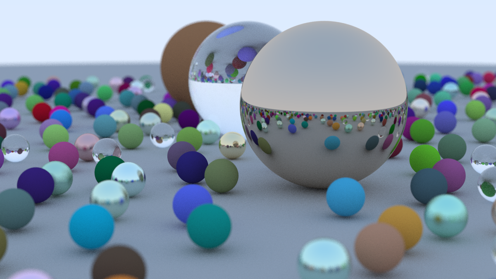

# raytracer

A CPU ray tracer in Rust, following Peter Shirley's
[_Ray Tracing in One Weekend_](https://raytracing.github.io/books/RayTracingInOneWeekend.html).



Diffuse, metal and glass materials, antialiasing, a positionable thin-lens
camera with depth of field, and multithreaded rendering with
[rayon](https://crates.io/crates/rayon).

## Layout

| Crate    | What it is                                                        |
|----------|-------------------------------------------------------------------|
| `tracer` | Core library: math, camera, materials, scenes, `render`. No UI/platform code. |
| `cli`    | Renders a scene to a PNG.                                         |

## Build and run

Needs a stable Rust toolchain from [rustup.rs](https://rustup.rs). On Windows,
rustup also needs the Visual Studio C++ Build Tools.

```sh
cargo run --release -p cli                       # cover scene → output.png
cargo run --release -p cli -- --scene materials  # three-sphere material demo
cargo run --release -p cli -- --width 400 --spp 50 -o preview.png
cargo run --release -p cli -- --help
```

Always use `--release` for renders: debug builds are dozens of times slower.

The cover at 1200×675 with 100 samples per pixel takes about four minutes on
8 threads. There is no BVH acceleration yet, so every ray is tested against
all ~480 spheres.

## Development

```sh
cargo test
cargo clippy --all-targets -- -D warnings
cargo fmt --check
```
