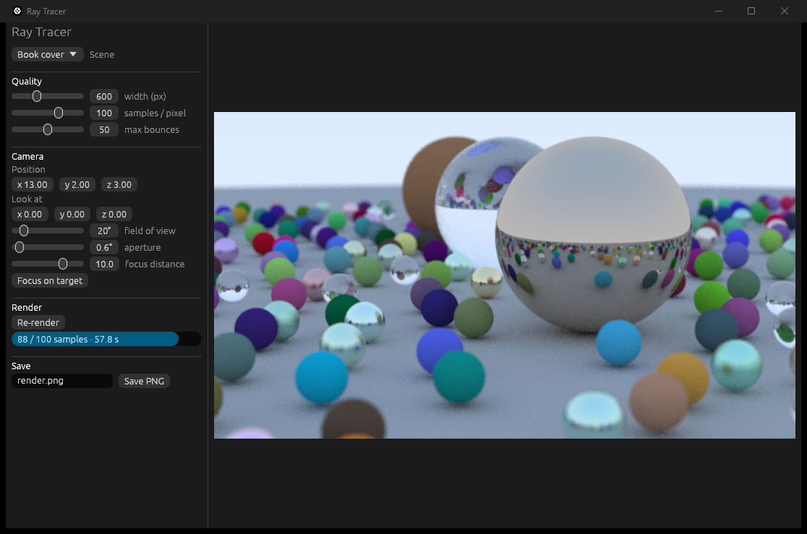

# raytracer

A CPU ray tracer in Rust, following Peter Shirley's
[_Ray Tracing in One Weekend_](https://raytracing.github.io/books/RayTracingInOneWeekend.html).


Diffuse, metal and glass materials, antialiasing, a positionable thin-lens
camera with depth of field, and multithreaded rendering with
[rayon](https://crates.io/crates/rayon).

## Layout

| Crate    | What it is                                                        |
|----------|-------------------------------------------------------------------|
| `tracer` | Core library: math, camera, materials, scenes, `render`. No UI/platform code. |
| `cli`    | Renders a scene to a PNG.                                         |
| `app`    | Desktop app ([egui](https://github.com/emilk/egui)): progressive preview with live controls. |

## Build and run

Needs a stable Rust toolchain from [rustup.rs](https://rustup.rs). On Windows,
rustup also needs the Visual Studio C++ Build Tools.

```sh
cargo run --release -p cli                       # cover scene → output.png
cargo run --release -p cli -- --scene materials  # three-sphere material demo
cargo run --release -p cli -- --width 400 --spp 50 -o preview.png
cargo run --release -p cli -- --help
```

Use `--release` for big renders. Dev builds optimize the `tracer` crate too
(see `Cargo.toml`), so they're usable, but release is still faster.

The cover at 1200×675 with 100 samples per pixel takes about four minutes on
8 threads. There is no BVH acceleration yet, so every ray is tested against
all ~480 spheres.

## Desktop app

```sh
cargo run --release -p app
```



The image refines one sample per pixel at a time. Pick a scene, change the
quality and camera settings (position, look-at, field of view, aperture,
focus distance), then press **Re-render**. **Save PNG** writes the current
image, however far it has refined.

On Linux, the app needs the usual X11/Wayland and OpenGL development
libraries (for example `libxkbcommon-dev`, `libgl1-mesa-dev`).

## Development

```sh
cargo test
cargo clippy --all-targets -- -D warnings
cargo fmt --check
```

## CI

GitHub Actions (`.github/workflows/ci.yml`) checks formatting, runs clippy
with warnings as errors, then builds and tests the whole workspace on
`ubuntu-latest`, `macos-latest` and `windows-latest`.
